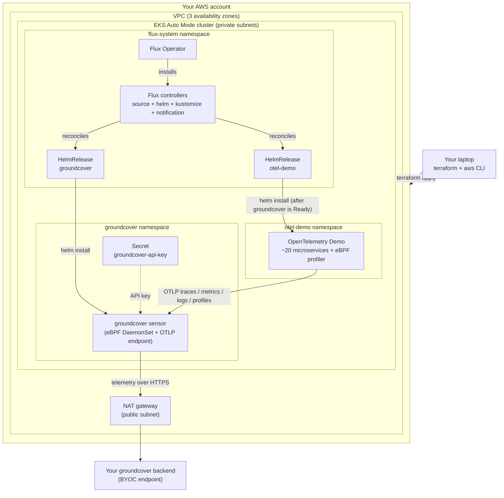
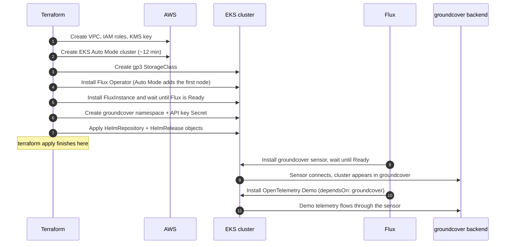

# groundcover Partner Kit

### EKS Auto Mode + Flux + groundcover + OpenTelemetry Demo

This kit builds a complete, observable Kubernetes demo environment in your own AWS account with one command. When it finishes you will have:

- A brand-new **Amazon EKS Auto Mode** cluster in its own VPC
- **Flux** (GitOps engine) running in the cluster
- The **groundcover sensor**, reporting to your existing groundcover backend
- The **OpenTelemetry Demo** (an e-commerce app made of ~20 microservices) sending traces, metrics, logs and profiles to groundcover

Plan on about **25 minutes** end to end, most of it waiting on AWS.

---

## Contents

1. [Architecture](#1-architecture)
2. [Design decisions](#2-design-decisions)
3. [Pinned versions](#3-pinned-versions)
4. [Before you start](#4-before-you-start)
5. [Step-by-step deployment](#5-step-by-step-deployment)
6. [Making changes later](#6-making-changes-later)
7. [Tearing it down](#7-tearing-it-down)
8. [Troubleshooting](#8-troubleshooting)
9. [What's in this directory](#9-whats-in-this-directory)

---

## 1. Architecture

### What gets built



### The layers

| Layer | What it is | Who manages it |
|---|---|---|
| **Network** | A VPC with public and private subnets in 3 AZs, and one NAT gateway for outbound internet | Terraform (`main.tf`) |
| **Cluster** | EKS with **Auto Mode** turned on. AWS provisions, patches and scales the nodes, and runs CoreDNS, kube-proxy, the VPC CNI, the EBS CSI driver and the load balancer controller for you | AWS, configured by Terraform (`main.tf`) |
| **GitOps engine** | The **Flux Operator** installs and maintains **Flux** from a single `FluxInstance` object | Terraform (`flux.tf`) |
| **Workloads** | Two Flux `HelmRelease` objects: groundcover and otel-demo | Flux, from objects Terraform applies (`charts/flux-apps/`) |

### What happens during `terraform apply`



Terraform finishes when Flux has been handed its instructions. Flux then needs another **5 to 10 minutes** to roll out groundcover and the demo. Step 10 below shows how to watch that.

---

## 2. Design decisions

**Why EKS Auto Mode?**
No node groups, no Karpenter install, no add-on version juggling. AWS runs the data plane, and nodes appear when pods need them. That keeps the Terraform small and leaves fewer things for a partner to get wrong.

Auto Mode is also where Terraform setups most often break. People declare the same add-ons Auto Mode already runs (CoreDNS, VPC CNI, kube-proxy, EBS CSI) or add managed node groups next to it. This kit declares neither. It uses the community `terraform-aws-modules/eks` module with only `compute_config.enabled = true` and the built-in `general-purpose` and `system` node pools.

**Why the Flux Operator?**
It's the Flux project's recommended way to install Flux. One `FluxInstance` object describes the whole Flux install, and the operator keeps it in that state. Terraform installs it with two Helm charts. A health-check hook makes Terraform wait until Flux is actually Ready before moving on, which avoids the classic race where Flux's CRDs don't exist yet.

**Why no Git repository?**
Partners shouldn't need to create a repo, a deploy key or an access token to run a demo. Terraform applies the Flux `HelmRelease` objects directly (packaged as the small local chart in `charts/flux-apps/`). From there Flux does exactly what it would do with Git: it installs, health-checks, retries and keeps drifted resources in line.

**Why is groundcover installed first?**
The demo services export telemetry to `groundcover-sensor.groundcover.svc.cluster.local`. The otel-demo `HelmRelease` uses `dependsOn: groundcover`, so Flux won't start the demo until the sensor is installed and healthy. That way no telemetry is lost and nothing crash-loops at startup.

**How is the API key protected?**
The groundcover key is a secret, so it never touches disk or Terraform state:

1. You pass it in an environment variable (`TF_VAR_groundcover_api_key`), not in a file.
2. Terraform declares it `ephemeral`, so it's never saved in a plan or the state file.
3. Terraform writes it once into a Kubernetes Secret using a *write-only* attribute (`data_wo`).
4. The groundcover chart reads that Secret by name (`global.groundcoverPredefinedTokenSecret`). The key never appears in Helm values or in the Flux objects.

**How do I authenticate to AWS?**
The kit never asks for or stores AWS keys. It uses whatever credentials your AWS CLI already uses: an SSO profile, an assumed role, or environment variables. Kubernetes and Helm get short-lived tokens from `aws eks get-token` with those same credentials.

---

## 3. Pinned versions

| Component | Version | Notes |
|---|---|---|
| Terraform | `>= 1.11` | Tested with 1.17. OpenTofu 1.11+ also works |
| AWS provider | `~> 6.70` | |
| Helm provider | `~> 3.3` | |
| Kubernetes provider | `~> 3.4` | Needed for write-only Secret data |
| terraform-aws-modules/eks | `~> 21.29` | |
| terraform-aws-modules/vpc | `~> 6.7` | |
| EKS Kubernetes | `1.36` | Standard support until Aug 2027 |
| Flux Operator | `0.61.0` | |
| Flux | `2.9.6` | Supports Kubernetes 1.34 to 1.36 |
| groundcover chart | `1.13.166` | |
| opentelemetry-demo chart | `0.42.6` | Demo app version 3.1.0 |

> **Want Kubernetes 1.37?** Flux 2.10 supports it but was released on 2026-10-26. Once it has had time to settle, set these in `terraform.tfvars`:
> ```hcl
> kubernetes_version    = "1.37"
> flux_version          = "2.10.0"
> flux_operator_version = "0.62.0"
> ```

---

## 4. Before you start

### Tools on your machine

| Tool | Why | Install (macOS) | Check |
|---|---|---|---|
| Terraform 1.11+ | Runs the kit | `brew tap hashicorp/tap && brew install hashicorp/tap/terraform` | `terraform version` |
| AWS CLI v2 | AWS login, and cluster tokens for Terraform | `brew install awscli` | `aws --version` |
| kubectl | Look at the cluster and open the demo | `brew install kubectl` | `kubectl version --client` |

On Linux or Windows, see the official install pages for [Terraform](https://developer.hashicorp.com/terraform/install), the [AWS CLI](https://docs.aws.amazon.com/cli/latest/userguide/getting-started-install.html) and [kubectl](https://kubernetes.io/docs/tasks/tools/).

### Access you need

- **An AWS account** where you can create VPCs, EKS clusters, IAM roles and KMS keys. `AdministratorAccess` is simplest for a demo account.
- **A running groundcover backend**, plus two values from it (Step 3):
  - a **sensor ingestion key**
  - your **BYOC endpoint**

### What it costs

While it runs, this environment bills for:

- the EKS control plane
- the EKS Auto Mode management fee
- the EC2 instances Auto Mode launches
- one NAT gateway and its data transfer
- a small amount of CloudWatch Logs and KMS

**Tear it down when you're done** (Section 7).

---

## 5. Step-by-step deployment

### Step 1: Get the kit

Copy this directory to your machine and open a terminal in it:

```bash
cd tf-kit
```

### Step 2: Sign in to AWS

Use **one** of these options.

**Option A: AWS SSO / IAM Identity Center (recommended)**

```bash
aws configure sso                       # one-time setup, creates a profile
aws sso login --profile my-sso-profile
export AWS_PROFILE=my-sso-profile
```

**Option B: assume a role.** Sign in however you normally do, then set `assume_role_arn` in Step 4.

**Option C: access keys** from your own tooling:

```bash
export AWS_ACCESS_KEY_ID=...
export AWS_SECRET_ACCESS_KEY=...
export AWS_SESSION_TOKEN=...            # if your keys are temporary
```

**Check it worked:**

```bash
aws sts get-caller-identity
```

You should see your account number and identity ARN. That identity automatically becomes cluster admin on the new cluster.

### Step 3: Get your groundcover values

1. **Sensor ingestion key.** Use either:
   - the groundcover CLI: `groundcover auth get-ingestion-key sensor`, or
   - the groundcover console: **Settings → Ingestion Keys**, then create or copy a **sensor** key.
2. **BYOC endpoint.** In the same **Ingestion Keys** tab, copy your BYOC endpoint, for example `example.platform.grcv.io`. Copy the hostname only, without `https://`.

### Step 4: Create your settings file

```bash
cp terraform.tfvars.example terraform.tfvars
```

Open `terraform.tfvars` and set at least:

```hcl
region                    = "us-east-1"                 # AWS region to build in
cluster_name              = "gc-partner-demo"           # also the cluster name in groundcover
groundcover_byoc_endpoint = "example.platform.grcv.io"  # from Step 3
```

Optional settings:

```hcl
groundcover_env              = "partner-demo"                          # environment label in groundcover
aws_profile                  = "my-sso-profile"                        # instead of exporting AWS_PROFILE
assume_role_arn              = "arn:aws:iam::123456789012:role/Admin"  # Step 2, Option B
admin_principal_arns         = ["arn:aws:iam::123456789012:role/Teammate"]
endpoint_public_access_cidrs = ["203.0.113.10/32"]                     # lock the API to your IP
```

> `terraform.tfvars` is listed in `.gitignore`. **Never put the API key in this file.**

### Step 5: Provide the API key

```bash
export TF_VAR_groundcover_api_key="paste-your-sensor-key-here"
```

The key exists only in this terminal session. If you open a new terminal, run this again. If you forget, Terraform will prompt you for it.

### Step 6: Initialize Terraform

```bash
terraform init
```

This downloads the providers and modules. It should finish with **"Terraform has been successfully initialized!"**

### Step 7: Preview (optional, but a good habit)

```bash
terraform plan
```

You should see **`Plan: 64 to add, 0 to change, 0 to destroy.`** Nothing is created yet.

### Step 8: Deploy

```bash
terraform apply
```

Review the plan, type **`yes`** and press Enter. Expect roughly:

| Stage | Time |
|---|---|
| VPC and IAM | ~2 min |
| EKS cluster | ~10 to 12 min |
| First Auto Mode node, Flux Operator, Flux | ~3 to 5 min |

It finishes with **`Apply complete!`** and prints some outputs.

### Step 9: Connect kubectl to the cluster

```bash
$(terraform output -raw configure_kubectl)
kubectl get nodes
```

You should see one or more nodes in `Ready` state. Auto Mode adds more as workloads arrive.

### Step 10: Watch Flux roll out groundcover, then the demo

```bash
kubectl get helmreleases -n flux-system -w
```

What you'll see, in order:

1. `groundcover` goes from `Unknown` to `True`, about 2 to 5 minutes
2. `otel-demo` waits with a *"dependency 'flux-system/groundcover' is not ready"* message, which is expected
3. `otel-demo` then goes to `True`, about 3 to 5 minutes

When both show `READY: True`, press `Ctrl+C`. To check the pods:

```bash
kubectl get pods -n groundcover
kubectl get pods -n otel-demo
```

### Step 11: Open the demo store

```bash
kubectl -n otel-demo port-forward svc/frontend-proxy 8080:8080
```

Leave that running, then open:

| URL | What it is |
|---|---|
| http://localhost:8080 | The Astronomy Shop storefront |
| http://localhost:8080/loadgen/ | The built-in load generator (already producing traffic) |
| http://localhost:8080/feature/ | Feature flags to inject failures for demos |

### Step 12: See it in groundcover

Open your groundcover console and pick the cluster named after your `cluster_name` (environment: `groundcover_env`). Within a few minutes you should see:

- the `otel-demo` workloads and their service map
- traces and logs from the demo services
- infrastructure metrics for the Auto Mode nodes
- continuous profiles from the eBPF profiler

**You're done.** 🎉

---

## 6. Making changes later

Remember to `export TF_VAR_groundcover_api_key=...` in any new terminal before running `terraform plan` or `terraform apply`.

| I want to... | Do this |
|---|---|
| Change otel-demo settings | Edit `values/otel-demo.yaml`, then `terraform apply` |
| Change groundcover settings | Edit `charts/flux-apps/templates/groundcover.yaml`, then `terraform apply` |
| Upgrade a chart | Change `groundcover_chart_version` or `otel_demo_chart_version` in `terraform.tfvars`, then `terraform apply` |
| Rotate the groundcover key | Export the new key, increase `groundcover_api_key_revision` by 1 in `terraform.tfvars`, then `terraform apply` |
| Give a teammate access | Add their IAM ARN to `admin_principal_arns`, then `terraform apply` |
| Force Flux to re-check now | `kubectl -n flux-system annotate helmrelease --all reconcile.fluxcd.io/requestedAt="$(date +%s)" --overwrite` |

The included `values/otel-demo.yaml` turns off the demo's own collector, Jaeger, Prometheus, Grafana and OpenSearch. groundcover replaces all of them. It also points every service's OTLP exporter, including the eBPF profiler, at the groundcover sensor.

---

## 7. Tearing it down

```bash
./scripts/destroy.sh
```

Type **`yes`** when Terraform asks. This takes about 15 minutes.

> **Use the script, not a bare `terraform destroy`.** The script:
> 1. Deletes the Flux HelmReleases, plus any LoadBalancer Services, Ingresses and volumes you may have added, while the cluster is still running. That lets AWS clean up the load balancers, network interfaces and EBS volumes it created for them. Terraform doesn't know about those, and left behind they would block VPC deletion.
> 2. Removes the in-cluster resources from Terraform's state. They disappear with the cluster anyway, and deleting them one at a time can hang on Flux finalizers.
> 3. Runs `terraform destroy` for the cluster, IAM and VPC.

If you use OpenTofu, run `TF=tofu ./scripts/destroy.sh`.

---

## 8. Troubleshooting

| Symptom | Likely cause | Fix |
|---|---|---|
| `ExpiredToken` or `no valid credential sources` | AWS login expired | `aws sso login --profile <profile>`, or refresh your keys |
| `terraform apply` asks for `var.groundcover_api_key` | Key not exported in this terminal | `export TF_VAR_groundcover_api_key=...` |
| `Unauthorized` or `You must be logged in to the server` | You're signed in as a different AWS identity than the one that created the cluster | Switch back to that identity, or add yours to `admin_principal_arns` and re-apply from the original identity |
| `aws: executable file not found` during apply | AWS CLI not on `PATH` | Install the AWS CLI v2 (Section 4) |
| `groundcover` HelmRelease stuck `False` | Wrong BYOC endpoint, or an invalid key | `kubectl -n flux-system describe helmrelease groundcover` and `kubectl -n groundcover get pods`. Check the endpoint is a hostname only, re-export the key, bump `groundcover_api_key_revision` and re-apply |
| `otel-demo` says the dependency is not ready | groundcover is still rolling out | Wait. It continues by itself once groundcover is Ready |
| Pods stuck `Pending` for a few minutes | Auto Mode is launching a node | Wait 1 to 3 minutes. `kubectl get nodeclaims` shows progress |
| Cluster doesn't show in groundcover | Sensor can't reach the backend | `kubectl -n groundcover logs -l app.kubernetes.io/name=sensor --tail=50` |
| Destroy hangs deleting the VPC or a subnet | A load balancer or network interface was left behind | In the EC2 console, delete load balancers and "available" network interfaces tagged with the cluster name, then run `./scripts/destroy.sh` again |

Useful status commands:

```bash
kubectl -n flux-system get fluxinstance          # Is Flux itself healthy?
kubectl -n flux-system get helmrepositories      # Can Flux reach the chart repos?
kubectl -n flux-system get helmreleases          # Are the apps installed?
kubectl -n flux-system logs deploy/helm-controller --tail=50
```

---

## 9. What's in this directory

```
.
├── README.md                     This file
├── versions.tf                   Terraform and provider version pins
├── providers.tf                  AWS auth; Kubernetes/Helm auth via `aws eks get-token`
├── variables.tf                  Every setting, with descriptions and defaults
├── terraform.tfvars.example      Copy to terraform.tfvars and edit
├── main.tf                       VPC, EKS Auto Mode cluster, default gp3 StorageClass
├── flux.tf                       Flux Operator, Flux, groundcover Secret, app objects
├── outputs.tf                    kubectl setup command and next steps
├── charts/flux-apps/             Flux HelmRepository + HelmRelease objects
│   └── templates/
│       ├── groundcover.yaml      groundcover sensor (installed first)
│       └── otel-demo.yaml        OpenTelemetry Demo (dependsOn groundcover)
├── values/
│   └── otel-demo.yaml            OpenTelemetry Demo settings
└── scripts/
    └── destroy.sh                Safe teardown
```
